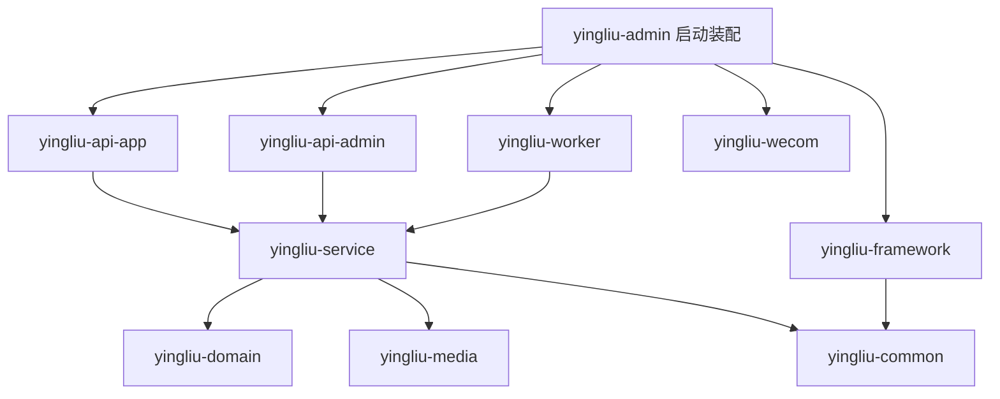

# 后端架构与维护约定

本次重构的交付目录是 `D:/PrivateSoftware/gitClaude/ticktok-api`，它是独立的纯后端 Maven 工程。前端应用不属于该工程。结构参考 RuoYi 的启动入口、框架能力与业务职责分离方式，保留本项目现有的 `domain`、`service` 及媒体、企微、定时任务 Module，不照搬 RuoYi 的业务实现。

## 模块职责

根工程 `yingliu-parent` 负责聚合构建、统一依赖和构建插件版本，包含以下 10 个 Maven Module。

| Module | 职责 | 维护约定 |
| --- | --- | --- |
| `yingliu-admin` | 唯一 Spring Boot 启动入口与运行配置，装配 App 和管理端接口 | 生成可执行 jar，集中 application 配置、数据库迁移脚本及整应用集成测试；名称不代表仅运行管理端接口 |
| `yingliu-framework` | Web 与持久化技术装配 | 集中异常映射、请求 Trace ID、MyBatis Mapper 扫描、分页插件和审计时间填充；不放具体业务 SQL |
| `yingliu-api-app` | App 请求入口、参数校验、身份解析与返回值适配 | 调用业务 Module，不承担应用启动或依赖聚合 |
| `yingliu-api-admin` | 管理端请求入口、身份解析与管理端接口适配 | 与 App 接口 Module 对等，不依赖 App 接口 Module |
| `yingliu-service` | 用例编排、业务规则、事务与 Mapper | 保留现有业务包组织；业务变更在对应领域内收敛 |
| `yingliu-domain` | 领域实体及业务数据结构 | 不依赖启动入口或接口 Module |
| `yingliu-common` | 公共返回结构、异常契约和通用能力 | 不承担 Servlet 过滤器和数据库装配；现有异常使用 `HttpStatus`，因此仍允许轻量 `spring-web` 依赖 |
| `yingliu-media` | 媒体上传、签名回调与存储适配 | 按 `controller`、`config`、`storage` 分包，保留现有存储行为 |
| `yingliu-wecom` | 企业微信集成扩展位置 | 按实际集成需要演进，避免仅为目录齐全引入空抽象 |
| `yingliu-worker` | 定时任务入口与调度配置 | 调用业务 Module 执行任务，不复制业务规则 |

## 依赖方向

以下图示表达职责方向，不替代各 Module POM 中的完整依赖清单。

`yingliu-framework` 使用 Spring/MyBatis 扩展点装配技术能力，不通过编译依赖反向引用业务 Module。Mapper 扫描包字符串仍指向业务 Mapper 所在的 `com.yingliu.service.**.mapper`。`yingliu-service` 不需要为了获得自动装配而依赖启动 Module；由 `yingliu-admin` 将它们装配到同一应用上下文。

框架提取集中变更位置（Locality），复用已有 Interface 获得 Leverage，不新增只转发一次调用的 shallow Module。对外 HTTP 路径、错误码、配置契约和事务语义都属于 Interface；文件搬迁不代表这些契约可随意修改。

## 媒体职责划分

- `com.yingliu.media.controller`：处理上传、签名和回调请求，负责 HTTP 参数与返回值适配。
- `com.yingliu.media.config`：集中配置属性、Bean 装配和本地资源映射。
- `com.yingliu.media.storage`：保留 `MediaStorage` 及本地、OSS 存储 Implementation，以及存储相关签名校验能力。

本地与 OSS 是已有的两个 Adapter，`MediaStorage` 是实际存在的 Seam。存储差异收敛在该 Seam 后方；控制器包移动不改变 URL、对象存储 key、回调验证或资源访问行为。配置读取优先使用明确的配置属性对象，避免控制器和上传工具分别解析同一个环境配置。

## 启动与配置归属

启动类保持 `com.yingliu.YingliuApplication`。保持根包可以继续扫描 `com.yingliu` 下的接口、业务、框架、媒体和任务代码。可执行 jar 由 `yingliu-admin` 构建，接口 Module 产出普通依赖 jar。

`yingliu-admin/src/main/resources` 统一持有运行配置与 Flyway 数据库脚本；测试专用资源跟随相应测试归属。通用配置描述稳定默认值，环境配置描述环境差异，部署环境通过既有环境变量提供连接信息和外部服务凭据。不要在多个 Module 中重复放置同名 application 配置来依赖偶然的 classpath 顺序覆盖。

依赖版本由根 POM 的 `dependencyManagement` 统一管理；构建插件版本由 `pluginManagement` 管理。子 Module 显式声明自己使用的依赖，避免依赖接口 Module 的间接传递获取基础设施。版本统一不代表自动启用插件，需要执行的插件仍须在有效构建配置中声明。

## 本次重构的兼容约束

- 保持主类全限定名、既有 HTTP 路径、请求和响应结构、业务错误码及 Trace ID 约定。
- 保持 App 与管理端既有登录域、令牌传递方式和鉴权语义。现有管理员鉴权中的权限参数处理属于后续业务审查事项，不能通过搬包隐式改变。
- 数据库迁移脚本可以改变存放 Module，但保留版本号、文件名与脚本内容，避免影响已部署数据库的 Flyway 校验。
- 保留 MyBatis Mapper 扫描路径和现有 `!test` profile 条件，避免测试环境意外启动数据库 Mapper。
- 保留本地/OSS 存储选择与媒体回调行为，不把包结构调整扩大为存储协议变更。

## 注释与后续维护

为 Module 和公开类型说明职责；为关键方法说明前置条件、事务范围、状态转换、幂等或并发约束。注释解释业务原因与不直观的取舍，不逐行翻译代码。环境配置要说明取值来源与适用环境；修改行为时同步更新注释，尤其注意登录令牌名称等可与 Implementation 脱节的说明。

管理员登录与权限代码当前包含管理端业务 SQL，保留在原职责位置；将其进一步抽离为业务用例需要单独验证登录、账号状态及授权契约。`framework` 不应成为收纳所有暂时难以分类代码的目录。

## 验证重点

先运行 Maven reactor 编译和现有单元测试，再确认整应用测试从启动 Module 加载。重点覆盖健康接口、异常映射、Trace ID、Mapper 装配、媒体存储选择和配置绑定。数据库集成测试需要 Docker/Testcontainers；若环境不可用而跳过，应明确记录跳过，不能描述为数据库链路验证通过。

还应核对可执行 jar 主类、启动资源及 Flyway 脚本是否唯一，部署构建是否指向 `yingliu-admin`。本文件说明架构和验证要求；实际执行结果以本次交付的验证记录为准。
